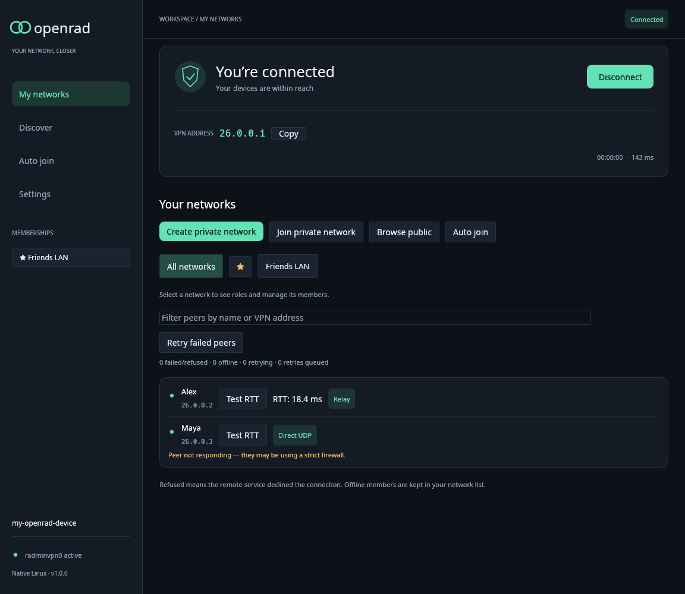
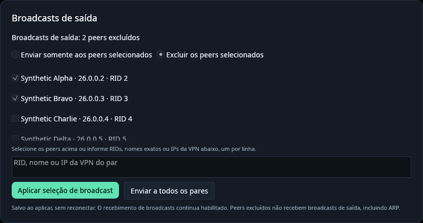

# OpenRad

[](docs/assets/openrad-intro.mp4)

[Watch the OpenRad intro animation (silent MP4)](docs/assets/openrad-intro.mp4)

The Windows desktop shows the OpenRad logo animation on first launch, then
offers a quick setup to choose a dark/light theme, configure auto-connection,
and optionally create the **OpenRad** desktop shortcut. The theme can be
changed at any time in **Settings > Workspace**. These choices are saved to
the user's existing profile; no additional identity or VPN is created.


OpenRad is an open-source Rust reimplementation of Radmin VPN. It provides a
virtual Ethernet interface, a native desktop client, a headless command-line
client, and a Paper server plugin for joining networks and communicating with
peers.

OpenRad is an unofficial community project and is not affiliated with Radmin or
Famatech. Linux is the established platform. Windows x64 support is experimental
and has so far been tested on Windows 10. macOS support is planned, but
development has not started.

## Clients

This repository is a monorepo with five clients sharing one wire format:

| Client | Path | Status | Version |
| --- | --- | --- | --- |
| Rust (desktop + CLI) | `src/`, `desktop/` | stable, canonical | 2.1.5 |
| Android | [`clients/android/`](clients/android/README.md) | beta | 2.1.5 |
| Python (research) | [`clients/python/`](clients/python/README.md) | research | 2.1.5 |
| Paper plugin (Minecraft servers) | [`clients/plugin/`](clients/plugin/README.md) | alpha | 2.1.5 |
| Fabric mod (Minecraft clients) | [`clients/mod/`](clients/mod/README-2.1.5.md) | alpha | 2.1.5 |

The Rust client is the source of truth for the wire format, the
`tests/fixtures/` vectors, and `locales/messages.json`. The Android and
Python clients mirror those files; `python3 scripts/check-sync.py` fails
when the mirrors diverge.

Quick build per client (run inside each directory):

```sh
# Rust (from repo root, requires Rust 1.95+)
cargo build --workspace --release --locked

# Android (from clients/android/, requires JDK 17)
./scripts/setup-android-sdk.sh  # first time only
./scripts/build.sh              # produces app/build/outputs/apk/debug/app-debug.apk

# Python (from clients/python/, requires Python 3.10+)
python3 -m venv .venv && .venv/bin/python -m pip install .
.venv/bin/python run_tests.py

# Paper plugin (from clients/plugin/, requires JDK 21)
./gradlew clean check
# Windows: .\gradlew.bat clean check
# produces build/libs/OpenRadPlugin.jar
```

## Features

- Desktop and headless CLI clients backed by the same VPN engine.
- One persistent per-user VPN session shared by the desktop and CLI.
- Public-network discovery and password-protected private networks.
- Network favorites and saved public/private network selections with paced batch joins.
- Peer connections over direct TCP, reliable UDP, or relay transport.
- Authenticated peer RTT tests, optional relay-only mode, and editable device names.
- Saved outgoing broadcast inclusion/exclusion lists shared between desktop and CLI.
- Linux TAP and Windows TAP-Windows6 virtual Ethernet interfaces.
- English, Portuguese, Russian, and Vietnamese interfaces.
- OS-backed credential storage for desktop identities.
- Live network search, background release notices, and bounded identity-reset recovery.



The screenshot uses synthetic networks and peers rendered on Linux.

## Memory use on Windows

In one user-reported Windows 10 idle comparison on the same network (76 peers,
one joined network), the official client used about **199 MB** (GUI and service
combined), while OpenRad used about **41 MB**. Results vary by system and workload.

OpenRad interoperates with regular Radmin VPN for its supported functionality.
Whether peers can establish a direct connection depends on their
network conditions, including NAT or firewall restrictions; OpenRad can use a
relay when a direct path is unavailable. See the [architecture guide](docs/architecture.md)
for protocol and transport details.

## Candidata 2.2.0 (ainda nao publicada)

A atualizacao **2.2.0** esta sendo preparada na branch `release/2.2.0-candidates`.
Ela corrige o aviso **Ver versao**, reforca o shutdown do servico, a validacao do
cliente Python, a busca Android e a compatibilidade de mixins Fabric e de testes Paper.
Os detalhes, a matriz de builds e os limites sao documentados nas
[notas da candidata 2.2.0](docs/releases/2.2.0.md). **Nao trate builds
experimentais Minecraft/Android como testados em dispositivo/jogo apenas pelo Gradle.**

## Download

Download the latest packages and SHA-256 checksums from the
[GitHub releases page](https://github.com/gringoestrangeiro/openrad/releases).
Version **[2.1.5](https://github.com/gringoestrangeiro/openrad/releases/tag/v2.1.5)** adds
**stealth block** (drop a VPN address's traffic in either direction while the peer stays
connected) to the desktop, CLI and Android, a Minecraft **Fabric client mod** (alpha),
Paper plugin builds for Minecraft 1.21.x and 26.x, and lower RAM use. It ships freshly
built Linux x86-64 and Windows x64 packages, an offline Windows installer, a signed
Android APK (beta), the plugin and mod JARs, build metadata, dependency notices, and
checksums. Read the [2.1.5 release notes](docs/releases/2.1.5.md) for upgrade behavior,
validation, and platform limitations, and the
[complete change inventory](docs/releases/2.1.5-changes.md) for every changed file.

- **Linux:** Extract the archive, keep `openrad` and `openrad-desktop` together,
  then follow the [Linux setup guide](docs/linux.md).
- **Windows:** Run `OpenRad-Setup.exe` from the release package. It installs the
  application and its TAP-Windows6 driver. See the [Windows guide](docs/windows.md)
  for installation, diagnostics, and current limitations.
- **Android (beta):** Install `openrad-2.1.5-android.apk` (Android 8.0 or newer).
  It is signed with the same key as 2.0.1 and installs as an update.
  See the [Android client guide](clients/android/README.md).
- **Minecraft server (Paper 1.21.x or 26.x, alpha):** Put the
  `OpenRadPlugin-2.1.5-paper-<version>.jar` for your Paper version in the server's
  `plugins/` folder; see [Minecraft server plugin](#minecraft-server-plugin-paper).
- **Minecraft client (Fabric 1.21–1.21.11 or 26.1–26.3, alpha):** Put exactly one
  `OpenRadClientMod-2.1.5-fabric-<version>.jar`, matching your game version, in the Fabric
  profile's `mods/` folder with the Fabric API; see the [mod guide](clients/mod/README-2.1.5.md).

## Quick start

On Linux, after extracting the release archive:

```sh
./openrad-desktop
```

Run the application as your normal user. The desktop stores credentials in the
OS credential store, which must be available and unlocked. The short-lived TAP
helper requests authorization in the system permission dialog using Polkit,
after trying existing noninteractive sudo authorization. Allow that dialog when
connecting; the detached service cannot reliably reuse a terminal's `sudo -v`.
Polkit and a session authentication agent must be running.

Closing the desktop window leaves the VPN service running. Use **Disconnect**
or `./openrad stop` to stop the shared session and remove its session interface
configuration. Open the desktop and CLI in either order; they use the same
identity, networks, and peer connections for the selected profile. When upgrading,
stop the old service and close the old desktop before replacing both binaries.

For headless use, initialize a CLI profile and start its background service:

```sh
./openrad init --node-name my-device
./openrad start
./openrad status
```

The CLI service persists after the terminal closes. Read the [CLI guide](docs/cli.md)
for identity imports, network management, private-network passwords, and service
commands. On Windows, use the installed **OpenRad CLI** shortcut; see the
[Windows guide](docs/windows.md#install-and-open-openrad).

Use `--data-dir PATH` with both frontends for a separate profile. New default
profiles use `$XDG_STATE_HOME/openrad` (usually `~/.local/state/openrad`) on Linux
and `%LOCALAPPDATA%\openrad` on Windows; existing desktop profiles are retained
when the default CLI profile has not been initialized.

Useful additions in 1.0.0:

```sh
./openrad ping PEER_RID
./openrad rename my-new-device-name
./openrad force-relay true
```

In the desktop, favorite networks with **☆**, select networks on **Auto join**,
and save a named configuration to reuse the selection. Enter private passwords
again when loading a list; configurations never store them. Batch joining starts
only when you choose **Join selected networks**.

Use **Settings → Outgoing broadcasts** to select several peers and send only
to them, or exclude them from normal distribution. The CLI supports
`openrad broadcast-peer RID [RID ...]` and `openrad broadcast-peer --exclude RID [RID ...]`.
Restore every eligible recipient with `openrad broadcast-peer --all`. The saved
selection applies without reconnecting; incoming broadcasts retain their current
behavior. See the [CLI guide](docs/cli.md#outgoing-broadcast-recipient) for routing
and eligibility details.



## Minecraft server plugin (Paper)

`OpenRadPlugin.jar` puts a **Paper 1.21.x** (Java 21) or **Paper 26.x** (Java 25) server directly on a Radmin
VPN/OpenRad network. Players using the official Radmin VPN (or OpenRad) join the
server at the plugin's `26.x.x.x` address; the host needs no VPN client, TAP/TUN
driver, root access or native libraries, so it also works on shared hosting.
The plugin is **alpha**: full multiplayer gameplay through the official Radmin
client has not been measured yet.

1. Download the JAR for your Paper version from the [2.1.5 release](https://github.com/gringoestrangeiro/openrad/releases/tag/v2.1.5):
   `OpenRadPlugin-2.1.5-paper-1.21.jar` for Paper 1.21.x, or `-26.1.1`, `-26.1.2`, `-26.2`
   or `-26.3` for Paper 26.x. Or build it (JDK 21 for 1.21.x; JDK 25 for 26.x):

   ```sh
   cd clients/plugin
   ./gradlew clean check                                   # Paper 1.21.x
   ./gradlew -PopenradPaperApi=26.3.build.+ clean check    # Paper 26.3
   # -> build/libs/OpenRadPlugin.jar
   ```

2. Copy `OpenRadPlugin.jar` into the server's `plugins/` folder and start the server.
3. In the **server console**, join your network (quote names with spaces):

   ```text
   orb join "My Network" networkPassword     # private network
   orb join "My Public Network"              # public network, no password
   orb public all-ptbr                       # or: public Minecraft networks from the catalog
   ```

4. Run `orb status`. It prints the address players use, for example
   `26.12.34.56`. Players join the same Radmin network and add that IP in
   Minecraft (port 25565 is the default and can be omitted).

The commands write `plugins/OpenRadPlugin/config.yml`, keep the password in the
owner-only `secrets.properties` (never in the YAML), enable the VPN, and apply
the change without restarting Paper. Passwords are refused when typed by a
player, because Paper logs player commands. Other useful commands:
`/orb help`, `/orb leave <network>`, `/orb enable|disable`, `/orb peers`,
`/orb minecraft options`, `/orb reload`. All require `openradplugin.admin`
(operators by default). The Minecraft backend is the server's own port on
`127.0.0.1`; `online-mode` is not changed, and the plugin refuses public
networks on `online-mode=false` servers unless explicitly acknowledged.

See the [plugin guide (Portuguese)](clients/plugin/README.md) for manual
configuration, ACLs, LAN advertisements, identity recovery and limits.

## Build from source

OpenRad requires Rust 1.95 or newer. On Debian or Ubuntu, install the native
dependencies listed below, then build the workspace:

```sh
sudo apt install build-essential pkg-config libx11-dev libxkbcommon-dev \
  libwayland-dev libgl1-mesa-dev iproute2 sudo pkexec gnome-keyring curl
git clone https://github.com/gringoestrangeiro/openrad.git
cd openrad
cargo build --workspace --release --locked
```

The build produces both the CLI and desktop application. See [Linux setup](docs/linux.md)
for GUI, credential-store, TAP, and troubleshooting requirements. Windows build
prerequisites and packaging instructions are in the [Windows guide](docs/windows.md).

### Build on Windows

Install Rust 1.95+ and the C++ build tools required by the
[Windows MSVC toolchain](https://rust-lang.github.io/rustup/installation/windows.html),
then build from the repository root:

```powershell
cargo build --workspace --release --locked
cargo test --workspace --locked
```

Keep `target\release\openrad.exe` and `openrad-desktop.exe` together. Install the
dedicated TAP adapter using the released setup before connecting. The published
Windows package is cross-built on Linux with MinGW-w64; native MSVC builds remain
unverified by the release builder. See [Windows build and packaging](docs/windows.md#linux-cross-build-and-offline-installer).

## Documentation

| Guide | Contents |
| --- | --- |
| [Linux setup](docs/linux.md) | Dependencies, permissions, TAP setup, and troubleshooting |
| [Windows setup](docs/windows.md) | Installer, TAP driver, diagnostics, and experimental support status |
| [Desktop usage](docs/desktop.md) | Desktop operation, profiles, identities, and connection logs |
| [CLI em português](docs/cli-pt-BR.md) | Guia completo do CLI, serviço e destino de broadcast |
| [CLI usage](docs/cli.md) | Commands, persistent service, profiles, and network administration |
| [Paper plugin](clients/plugin/README.md) | Minecraft server plugin: install, `/orb join` setup, commands, configuration, and validation scope |
| [Architecture](docs/architecture.md) | Components, protocol, transports, and platform interfaces |
| [Performance](docs/performance.md) | Benchmark methodology and results |
| [Changelog](CHANGELOG.md) | Version history |
| [2.1.5 release](docs/releases/2.1.5.md) | Stealth block, Fabric mod, multiversion plugin, RAM, packages, upgrading, validation, and limitations |
| [2.1.5 change inventory](docs/releases/2.1.5-changes.md) | File-by-file account of all changes since v2.1.0 |
| [2.1.0 release](docs/releases/2.1.0.md) | Paper plugin, presence fix, packages, upgrading, validation, and limitations |
| [2.1.0 change inventory](docs/releases/2.1.0-changes.md) | File-by-file account of all changes since v2.0.1 |
| [2.0.1 release](docs/releases/2.0.1.md) | Packages, upgrading, verification, and limitations |
| [2.0.1 change inventory](docs/releases/2.0.1-changes.md) | File-by-file account of all changes since v2.0.0 |
| [2.0.0 release](docs/releases/2.0.0.md) | Monorepo with Android and Python clients |
| [2.0.0 change inventory](docs/releases/2.0.0-changes.md) | File-by-file account of all changes since v1.5.0 |

## Development

The default workspace tests are headless and unprivileged. To check formatting,
run the tests, and lint all targets:

```sh
cargo fmt --all -- --check
cargo test --workspace --locked
cargo clippy --workspace --all-targets --locked -- -D warnings
```

The optional Linux interface test is ignored by default because it creates a TAP
interface and requires elevated privileges. See [Linux setup](docs/linux.md#optional-interface-test)
before running it.

The repository is organized as follows:

| Path | Purpose |
| --- | --- |
| `src/` | Shared VPN library, protocol, transports, platform interfaces, and CLI |
| `desktop/` | Native desktop application and background engine |
| `tests/` | Integration tests and synthetic protocol fixtures |
| `docs/` | Platform guides, architecture, and performance notes |
| `locales/` | Complete four-language message catalog |
| `scripts/`, `packaging/` | Release archives, Windows installer, and packaging regressions |

## Security and local data

Desktop credentials are stored in the OS credential store. The CLI saves its
identity and service state in a private profile; treat identity files as
credentials and never commit or share them. Connection diagnostics may contain
peer IDs, addresses, and network names, but should not contain passwords,
session keys, or packet contents. Review local logs before sharing them.

Test fixtures use synthetic credentials and key material. See the platform and
[CLI guides](docs/cli.md) for profile locations and diagnostic details.

## Credits

asimplestray contributed approximately 95% of OpenRad's cryptography work,
including RSA session setup, the secure handshake, and encrypted channels. The
MIT license also credits him as a copyright holder.

[Baptiste Rajaut (@baptisterajaut)](https://github.com/baptisterajaut)
contributed a robustness audit and fixes in [PR #1](https://github.com/gringoestrangeiro/openrad/pull/1).

## License

OpenRad is distributed under the [MIT License](LICENSE).
