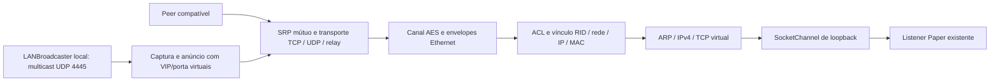

# Arquitetura

O serviço Radmin fornece identidade, IP virtual, membros, credenciais temporárias por conexão e candidatos. Um socket conectado ou um ticket pareado não autoriza tráfego: ainda são obrigatórios os proofs SRP e a negociação cifrada do serviço Ethernet.

| Pacote | Responsabilidade |
| --- | --- |
| `config` | YAML validado e referências a arquivo privado de senhas; backend numérico de loopback. |
| `protocol` | TLVs limitados, singleton, inteiros sem sinal e UTF-16BE. |
| `crypto` | RSA bootstrap, SH/SRP nas duas direções, canal CBC, identidade atômica e permissões privadas. |
| `session` | Registro com marcador durável, autenticação do controle, attachment e UES. |
| `network` | Membership, papéis, joins públicos/privados correlacionados, descoberta pública e operações de gerenciamento. |
| `peer` | Ofertas CID/RID, candidatos, corrida de transportes, retenção do coordenador e autenticação do túnel. |
| `transport` | Framing TCP, rendezvous, UDP confiável e UES; pareamento relay. |
| `tunnel` | Handshake de serviço, versão/MAC, envelopes Ethernet e keepalives. |
| `security`, `link` | Checksums, parsing e admissão exata de origem/destino/porta. |
| `bridge`, `virtual` | Máquina TCP passiva, retransmissão/janelas/reordenação/half-close e conexão ao backend. |
| `runtime` | Uma geração de attachment, workers por peer, ACL atual, reconexão e snapshots. |
| `discovery` | Captura local de anúncios Minecraft Java e emissão multicast pelo túnel autorizado. |
| plugin Paper | Ciclo de vida, autorização dos comandos, fila administrativa e publicação na thread correta. |

Cada attachment possui um worker de controle. Os peers usam workers virtuais limitados pelo executor e até oito handshakes simultâneos. O TCP virtual usa um único selector com sockets não bloqueantes. A thread do Paper não processa payloads, criptografia ou sockets.

A identidade é carregada sob lock. O primeiro uso autentica o bootstrap, registra e persiste uma identidade nova; uma emissão incerta não é repetida automaticamente. Cada reconexão fecha a geração anterior, elimina grants e fluxos TCP e autentica outra sessão. Workers antigos não podem remover os recursos de uma substituição do mesmo RID.

A autorização exige que **a mesma rede** satisfaça nome configurado, ACL por RID/rede e papéis ativos do servidor e do peer. VIPs elegíveis duplicados ou iguais ao próprio IP são recusados. IP vem da membership autenticada e MAC da negociação cifrada; RID não é convertido em IP.

O TCP virtual aceita somente conexões destinadas ao próprio VIP e à porta exposta. Ele abre exclusivamente o endereço de loopback pré-configurado. Respostas são serializadas para a fila do mesmo peer. Quedas por pressão de fila são recuperadas pela retransmissão TCP; bytes cifrados nunca são descartados depois de avançar a corrente CBC.

A implementação é um endpoint de serviço IPv4/TCP, com emissão restrita de anúncios Minecraft LAN em IPv4/UDP multicast. Não há roteamento genérico, IPv6 virtual, ICMP ou recepção UDP virtual para serviços. O transporte externo pode usar UDP e endereços IPv6. Limites específicos estão em `virtual-tcp.md`, `lan-discovery.md` e `transport-parity.md`.
