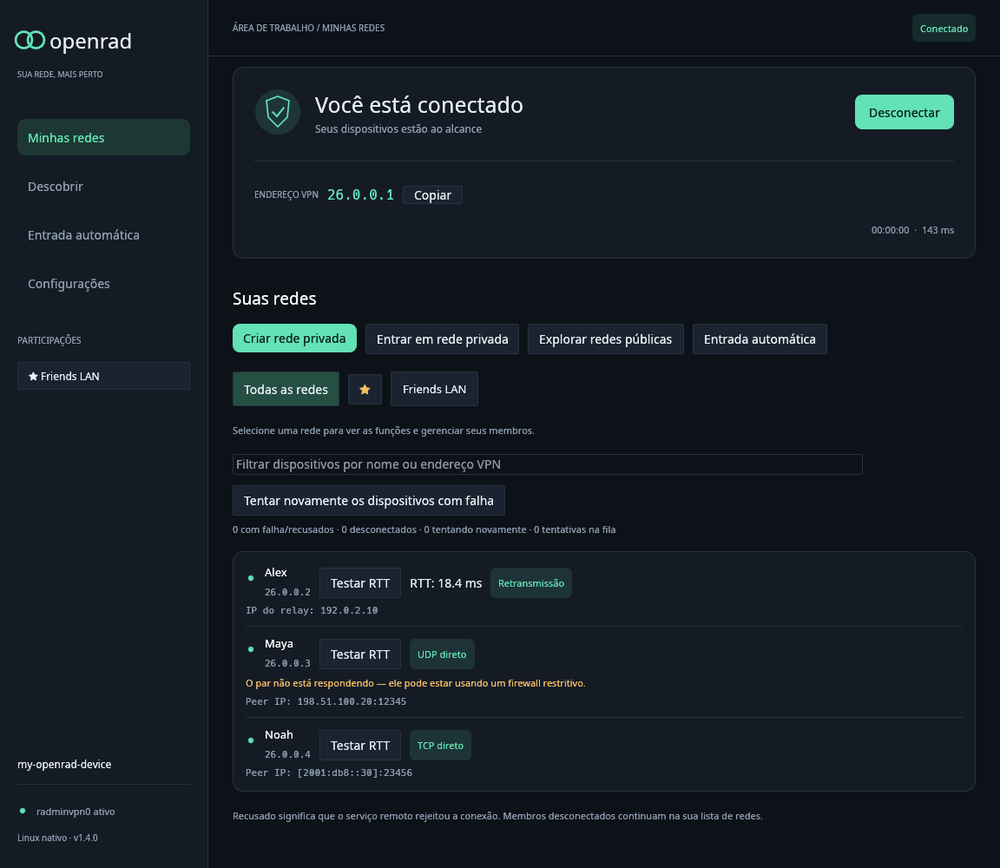
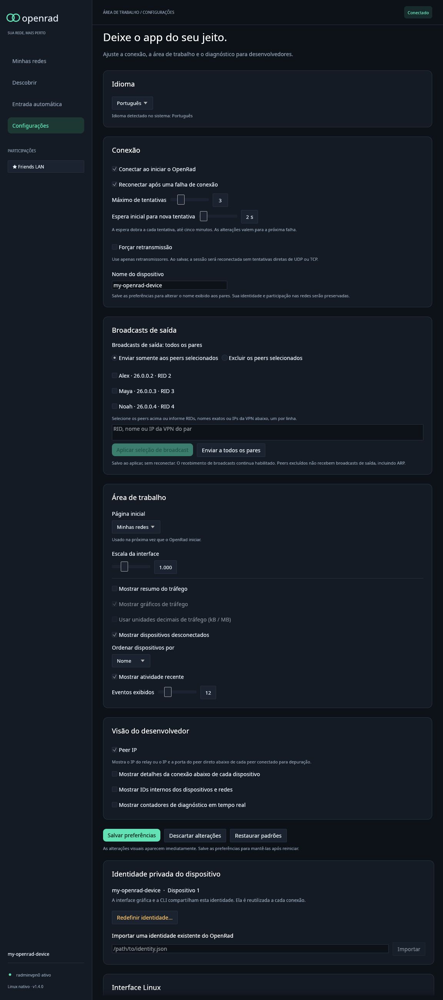

# OpenRad 1.5.0 — Peer transport display, faster packet path and fault containment

OpenRad 1.5.0 adds an optional per-peer transport address display, speeds up
the packet path without changing wire formats, and contains faults that
previously stalled or dropped channels. A full UDP send buffer is now
congestion with bounded retries instead of a channel failure, malformed member
updates no longer mutate the roster or roles, and engine panics become errors
with normal cleanup.

This release includes every changed and added file since freshly fetched
`origin/main` at `c96e5ab7eb1cf65cf8457603cbb3b32100a2da01` (v1.4.0).
Both platforms are rebuilt from the same committed 1.5.0 source. Read the
[changelog](../../CHANGELOG.md#150--2026-10-12) and
[complete file inventory](1.5.0-changes.md). Windows remains experimental.

## Downloads and upgrade

- `openrad-v1.5.0-linux-x86_64.tar.gz`: CLI and desktop, English and Brazilian
  Portuguese guides, synthetic screenshots, dependency/standard-library notices,
  build/library metadata, release history and internal checksums.
- `OpenRad-Setup-1.5.0.exe`: offline Windows installer with all three
  executables, pinned signed TAP-Windows6 9.27.0 driver, corresponding driver
  source, installer source, guides, notices and audited installation manifest.
- `openrad-1.5.0-windows-x86_64-setup.zip`: installer plus documentation,
  validation, build/import/driver metadata, screenshots and checksums.
- `openrad-1.5.0-windows-x86_64-test.zip`: portable Windows CLI and desktop,
  launch/diagnostic tools, guides, metadata and notices. Requires an already
  installed dedicated TAP adapter and elevation.
- `SHA256SUMS`: SHA-256 checksums for all four distribution files.

Run `openrad stop` and close the desktop before replacing binaries or running
the Windows installer. Keep the CLI and desktop from the same release together.
Closing a frontend leaves the shared service running; stopping it ensures the
next start loads the new engine. On Windows, run the installer with UAC
administrator approval. If it reports `Error opening file for writing` for
`openrad.exe`, choose Retry after `openrad stop` plus closing the desktop, or
Abort and re-run — never click Ignore: a skipped file keeps the old bytes and
the setup worker then refuses with `An installed file failed its integrity
check: <path>`, naming the divergent file. That message means an incomplete
copy (often a prior Ignore on a locked file), a partial download, or an
antivirus quarantine. Re-run setup after stopping OpenRad; if it persists,
re-download and verify `SHA256SUMS`. Existing identities, memberships, favorites,
join configurations and credential storage are retained. No identity reset or
new device registration is required.

Both Cargo package versions, the lockfile and all fresh executables report
1.5.0. Linux binaries use the local Rust 1.98.1 builder; Windows x64 binaries
are cross-built with Rust 1.98.1 / MinGW-w64. Package metadata records actual
compilers, committed source and builder provenance. The Linux CLI requires
glibc 2.34 or newer and the desktop requires glibc 2.35 or newer, plus the
libraries in the [Linux guide](../linux.md).

## Peer transport display

In **Settings**, enable **Peer IP** to show the authenticated transport address
for each connected peer. Direct channels show the full socket address:

`Peer IP: 192.0.2.10:443`

Relay channels show only the relay address:

`Relay IP: 203.0.113.40`

The row is hidden when the peer is not `Connected`, when the endpoint is
unknown (older service), or when the setting is off (the default). The service
publishes `endpoint` through snapshots with serde-default compatibility; the
desktop remeasures cached rows when it changes. Controls are translated into
English, Portuguese, Russian and Vietnamese.

Both screenshots are rendered on Linux with synthetic names, addresses and
peers.

## Packet path and robustness

- Sliced 8-byte CRC, 32-block pipelined CBC receive, word-wise record
  authentication, cached handshake prime, 8 KiB TCP/relay read-ahead, single
  read-timeout setup, nonblocking Linux TAP reads, in-place membership updates
  and single-pass display-name decoding. Checksum, padding, chaining and
  authentication results are unchanged.
- A nonblocking UDP socket whose send buffer fills during a burst retries soon
  (10 ms) without counting as a failed attempt; sustained congestion now fails
  after 35 s instead of retrying forever. ACK and punch replies are
  best-effort; other socket errors still fail the channel.
- Malformed `0x131e` member updates are validated before peers or roles are
  applied. Previously a bad update deleted the member; the intermediate fix
  kept the peer but still mutated roles.
- Engine, control, peer and setup panics become errors with cleanup and retry
  instead of orphaned threads or peers that never report `Closed`. Poisoned
  state, policy and log locks recover; service/config locking is split so
  preference saves (fsync or credential-store prompts) no longer stall packet
  delivery snapshots.

See the [architecture guide](../architecture.md) and the
[performance guide](../performance.md#sliced-checksum-pipelined-cbc-receive-and-fault-containment)
for packet-path details, loopback microbenchmarks and robustness limits. All
numbers there are loopback-only and cannot be read as VPN throughput.

## Performance and validation

Loopback-only medians from the performance guide (Linux x86-64, Rust 1.98.1):
ENET CRC 3.8×, record authenticator 5.9×, TCP-record receive 5.5×, decrypt
2.2×; handshake unchanged within noise; reliable-UDP loopback about 35% less
CPU per message. These isolate receive/checksum cost and exclude TAP,
encryption on the full path and real networks.

Implementation validation completed before release preparation:

- **329 default Linux workspace tests passed**, with eight optional tests
  ignored. Regressions cover refused-send retry and congestion timeout, roster
  and role integrity, eligibility, display decoding, poisoned locks, panic
  containment, peer-IP display, broadcast selection and existing wire vectors.
- **Formatting and Linux/Windows GNU Clippy passed**, with warnings denied.
  Every Windows workspace test executable compiled.
- The optional CPU-rendered tests passed. Screenshots covering peer-IP display
  and settings were inspected, including per-language toggle behavior.

These implementation checks are reused for this release and were not rerun for
version and release-document changes. Release checks verify freshly compiled
executable versions, ELF/PE architecture and imports, dependency and standard-
library notices, pinned driver/source hashes, every extracted installer payload
file, packaged documentation links and internal/external SHA-256 checksums.
Build metadata identifies the committed source and clean worktree.

No real VPN or active user service is stopped during build/package validation.
Cross-compilation, synthetic rendering and Wine version checks do not establish
native Windows TAP, UAC, credential-store, named-pipe ACL, Direct3D or real
Radmin interoperability. Native Windows validation remains outstanding.
Applications are unsigned; the TAP driver is the unchanged upstream signed
package. The previous broadcast, connection and Windows recovery changes are
retained; see the [1.4.0 guide](1.4.0.md).
